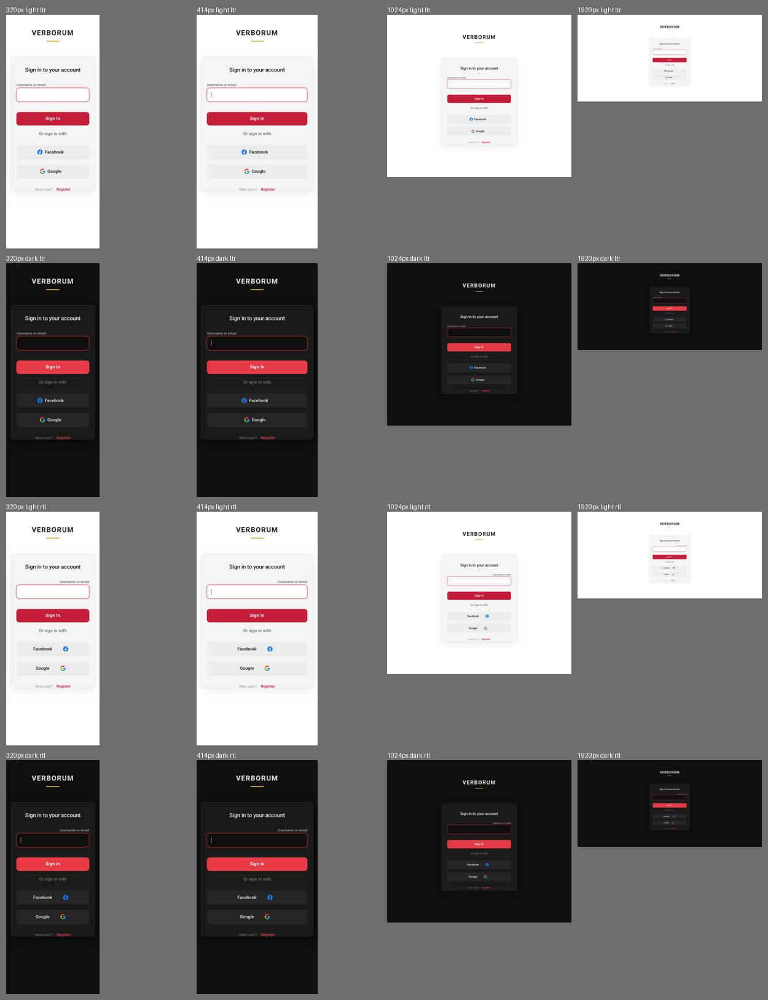
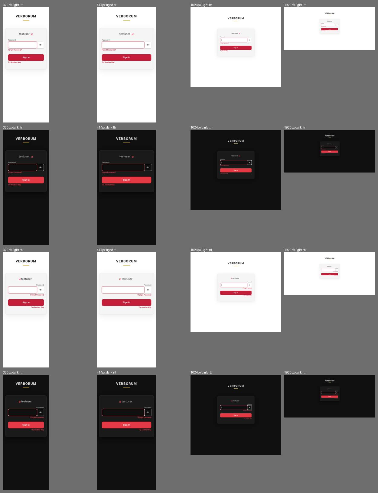
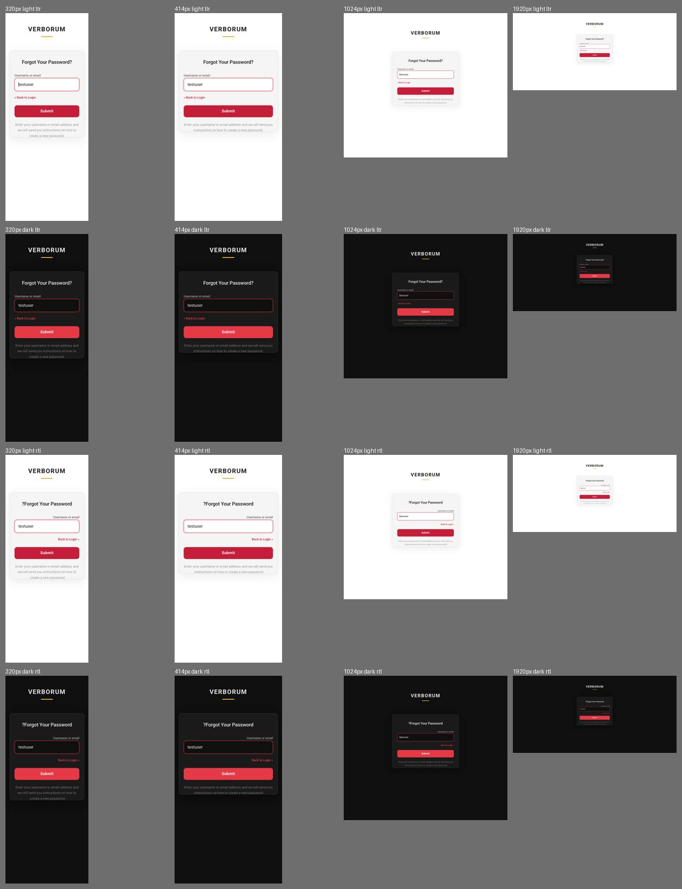
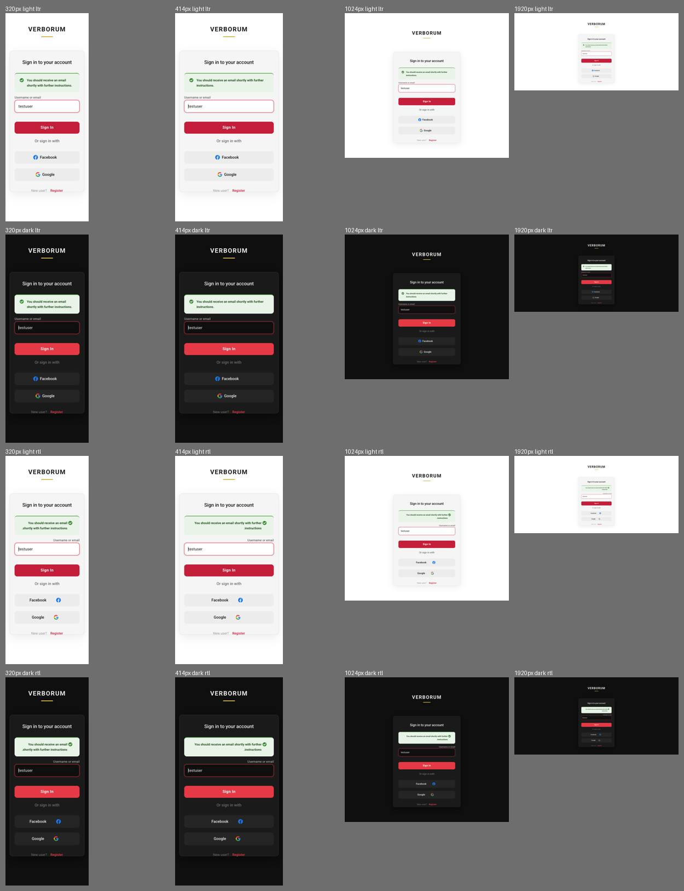
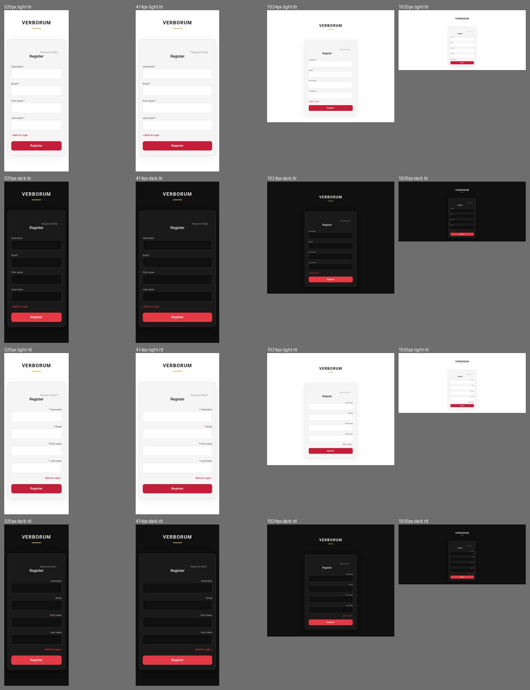
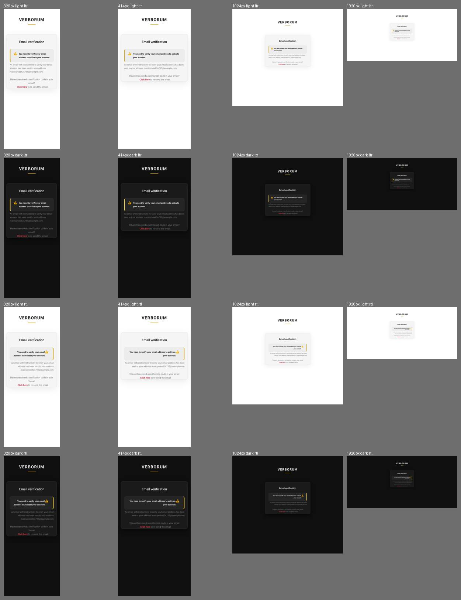
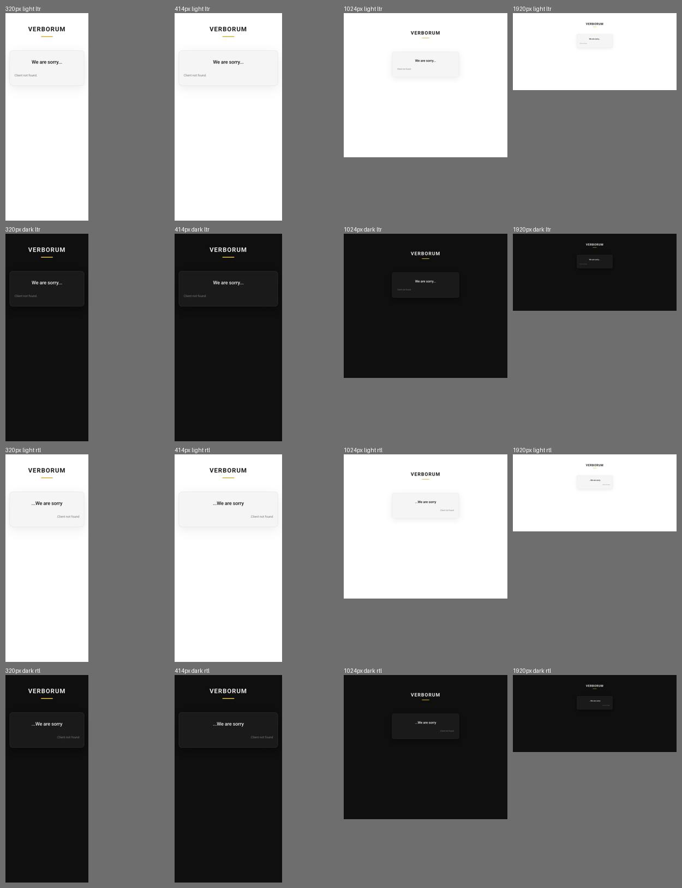
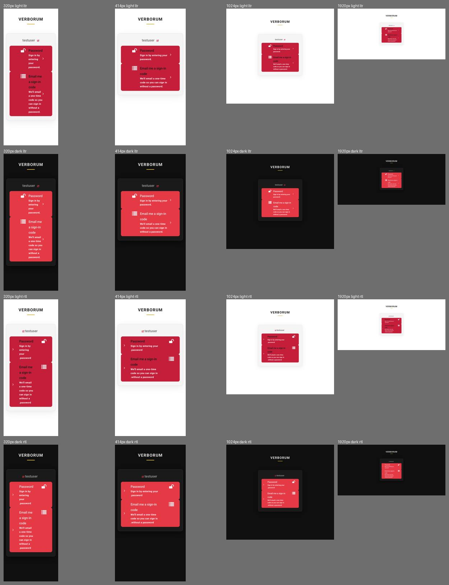
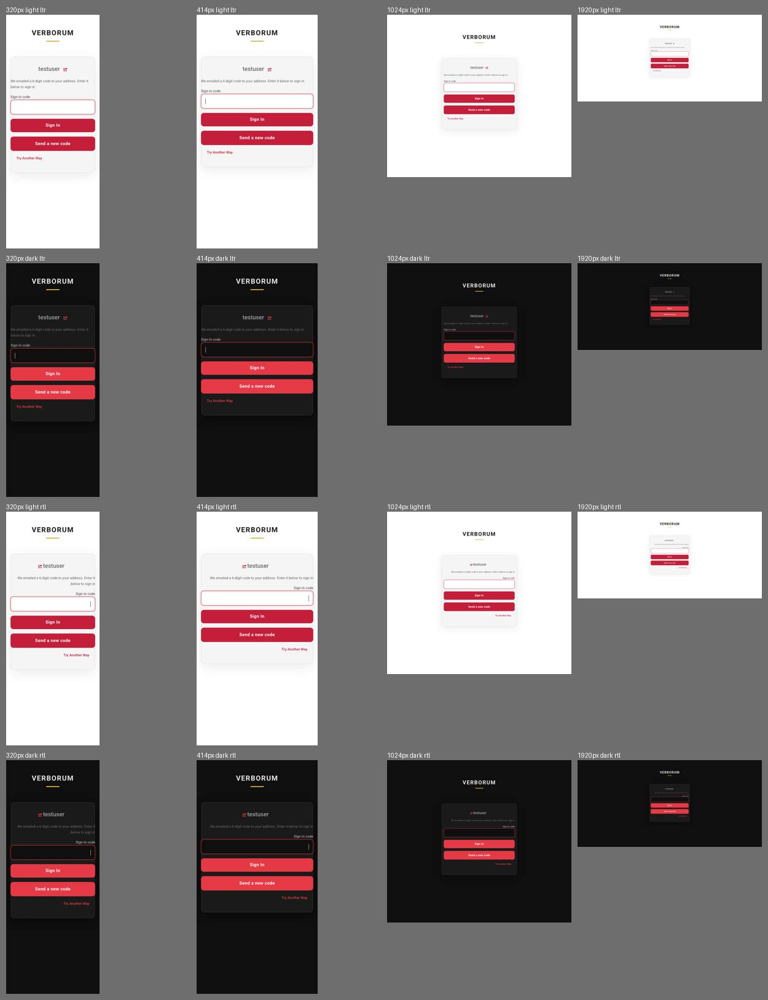

# Login theme — responsive matrix (P5A-06, 2026-10-31)

Keycloak 26.8.0, theme `verborum`. Script: `scripts/theme-matrix/matrix.js`.
Each page was opened at **320, 375, 414, 768, 1024 and 1920 px**, in **light and dark**, **left-to-right and
right-to-left** (`dir="rtl"` set on the page, English text): 9 pages × 24 = **216 screenshots**. The overview
images below show 320, 414, 1024 and 1920 px, four variants each.

| Page | Overview | Overflow before | Overflow after |
|---|---|---|---|
| Login |  | 7 px sideways scroll at 320–414 px | none |
| Password step |  | eye button outside the card at 320 px | none |
| Forgot password |  | 7 px at 320–414 px | none |
| Mail sent |  | 7 px at 320–414 px | none |
| Register |  | none | none |
| Verify email |  | 7 px at 320–414 px; pale warning box in dark | none; box themed |
| Error |  | none | none |
| Try another way |  | eye/field row wider than card at 320 px | none |
| Email code |  | field row wider than card at 320 px | none |

Result: before 54 findings, after **0**. A finding is any visible element whose box leaves the viewport, or a
page wider than the viewport.

## What changed (`verborum.css`, section "Responsive layout")
- No sideways scroll: the stock `#kc-info` negative margins are removed; `box-sizing: border-box` everywhere.
- A 16 px gutter (plus safe areas) around the card; the card is `width: 100%` up to 420 px.
- Under 480 px: smaller padding and wordmark, 16 px input text (no iOS zoom), 44 px touch targets.
- Password field and eye button share a flex row that can shrink.
- Long words and addresses wrap. Short landscape screens lose the big top gap. Above 1600 px a larger wordmark.
- RTL: social icon margin and the eye button corners mirror; the code and name fields use `unicode-bidi: plaintext`.
- Warning and info boxes use the theme surface instead of the stock pale orange or blue.

## Not covered
- RTL is simulated with `dir="rtl"` on English text. A real Arabic or Persian page (glyph shaping, longer
  strings) is checked after realm localization (`P5A-07`, `P5A-08`).
- Real phones: only Chrome (headless) was used. Safari on iOS and Android Chrome are for the owner's eyes.
